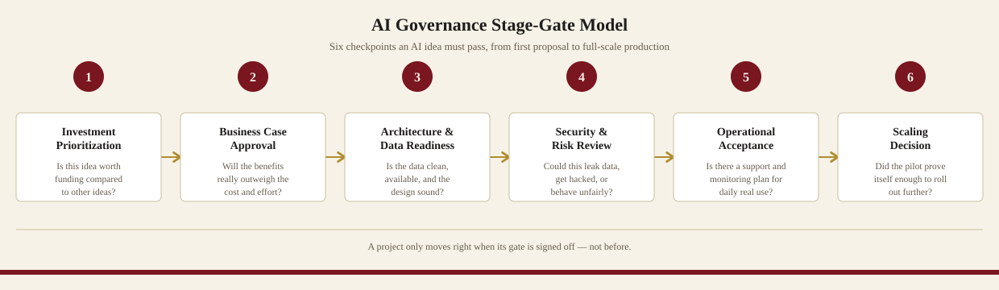
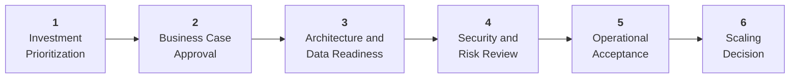
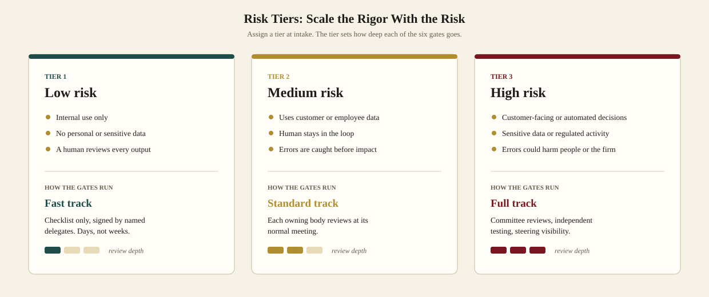

# AI Governance Stage-Gate Framework

A simple, six-gate governance model for taking an AI idea from "someone had a good idea" to "it's safely running in production" — designed and used by [Imran Sheikh](https://linkedin.com/in/imranazhar) while leading Data, AI & Enterprise Technology at a large UAE media and communications organization.



## Why this exists

Most organizations either over-govern AI (a single giant sign-off that slows everything down) or under-govern it (no checks at all until something goes wrong). This framework splits governance into six lightweight checkpoints spread across the life of a project, so risk is caught early and cheaply — while low-risk ideas can still move fast.

## Start here

| If you want to... | Go to |
|---|---|
| Understand each gate in plain language | [`docs/framework.md`](docs/framework.md) |
| Make gates fast for low-risk ideas and thorough for high-risk ones | [`docs/risk-tiers.md`](docs/risk-tiers.md) |
| See who is Responsible, Accountable, Consulted, and Informed | [`docs/raci.md`](docs/raci.md) |
| Know what "passed" means, how to escalate, and what to measure | [`docs/gate-criteria-and-metrics.md`](docs/gate-criteria-and-metrics.md) |
| Use it on your own project | [`templates/stage-gate-checklist-template.md`](templates/stage-gate-checklist-template.md) |

## The six gates, at a glance

| # | Gate | Question it answers |
|---|---|---|
| 1 | Investment Prioritization | Is this idea worth funding compared to other ideas? |
| 2 | Business Case Approval | Will the benefits really outweigh the cost and effort? |
| 3 | Architecture & Data Readiness | Do we have the right data and technical foundation? |
| 4 | Security & Risk Review | Could this leak data, get hacked, or behave unfairly? |
| 5 | Operational Acceptance | Is there a support and monitoring plan for daily real use? |
| 6 | Scaling Decision | Did the pilot prove itself enough to roll out further? |



## Rigor scales with risk

Every project gets a risk tier at intake. The tier decides how deep each gate goes, so a low-risk idea can pass in days while a high-risk one gets a full review.



Details: [`docs/risk-tiers.md`](docs/risk-tiers.md).

## Where this fits

Stage gates are one part of a larger system: the **AI operating model**, which defines how an organization embeds AI into its strategy, processes, people, technology, data, and governance. The gates are the decision rhythm. The operating model supplies the committees and roles that own each gate.

If you are asking "who should sit on these committees?" or "how do we organize for AI in the first place?", see the companion repository:

**[AI Operating Model Playbook](https://github.com/imransheikh-ai/ai-operating-model-playbook)** — archetypes, the six dimensions, roles and decision rights, a maturity model, and a 90-day setup tutorial, including a step-by-step guide to [using it with these stage gates](https://github.com/imransheikh-ai/ai-operating-model-playbook/blob/main/docs/06-using-with-stage-gates.md).

## Repo contents

```
ai-governance-stage-gate-framework/
├── README.md                                  ← you are here
├── LICENSE                                    ← CC BY 4.0
├── docs/
│   ├── framework.md                            ← full explanation of every gate
│   ├── risk-tiers.md                           ← fast, standard, and full tracks
│   ├── raci.md                                 ← complete RACI by gate and by role
│   ├── gate-criteria-and-metrics.md            ← pass criteria, escalation, measures
│   ├── gate-diagram.svg                        ← the visual model
│   └── risk-tiers.svg                          ← the risk tier visual
└── templates/
    └── stage-gate-checklist-template.md        ← reusable checklist for any project
```

## License

Released under [Creative Commons Attribution 4.0 International (CC BY 4.0)](LICENSE). You may copy, adapt, and use this material, including commercially, as long as you give credit.

## About

This framework reflects governance practices I designed and chaired for enterprise AI product delivery — covering Generative AI, RAG, and AI agent solutions — in a regulated communications environment. Details here are generalized for public sharing. It is a starting point to adapt, and it is not legal or regulatory advice.

[LinkedIn](https://linkedin.com/in/imranazhar) 
