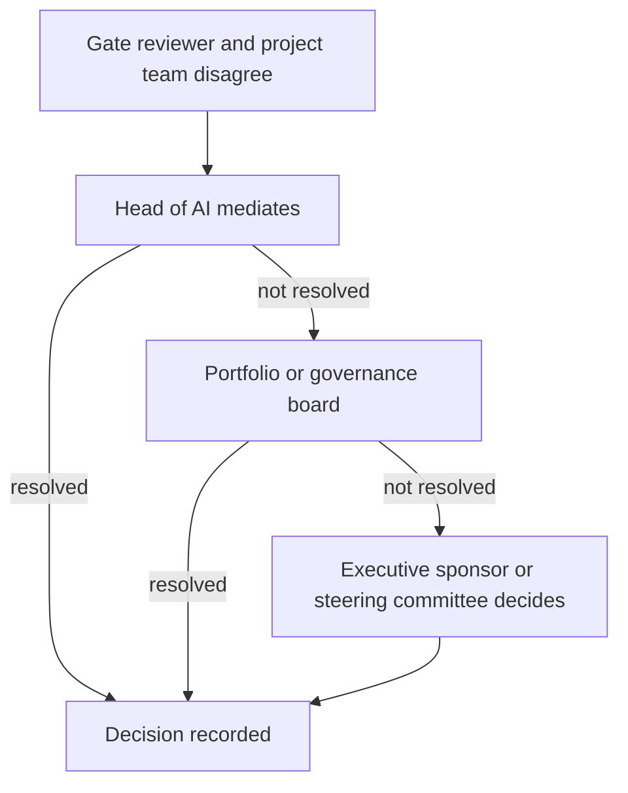

# Gate criteria, escalation, and metrics

[← Back to README](../README.md) · [Framework](framework.md) · [Risk tiers](risk-tiers.md) · [Full RACI](raci.md)

The framework says what each gate checks. This page says what "passed" means, what to do when a gate is not passed, and how to tell whether the framework itself is working.

## The four possible decisions

Every gate ends in one of four recorded decisions.

| Decision | Meaning | What happens next |
|---|---|---|
| **Pass** | All criteria met | Work on the next stage starts |
| **Pass with conditions** | Minor gaps, each with an owner and a date | Work starts. Conditions are checked at the next gate |
| **Rework** | Material gaps | The team fixes them and returns to the same gate |
| **Stop** | The idea should not continue | Recorded with reasons. Lessons go to the portfolio owner |

A "Stop" is a successful use of the framework. It means a weak or risky idea ended early and cheaply.

## Pass criteria by gate

A gate is passed when every statement is true and the evidence exists.

### Gate 1. Investment Prioritization

- The problem, the people it helps, and a rough size of benefit and effort are on one page
- The idea was ranked against the other candidates in the portfolio
- A business sponsor is named
- A risk tier has been proposed

### Gate 2. Business Case Approval

- Costs cover people, tools, and running costs after launch, not only the build
- Benefits are stated as measures that can be checked later, with a baseline
- One named person is accountable for the benefits
- Finance has reviewed the numbers
- The measures that Gate 6 will use are agreed now

### Gate 3. Architecture and Data Readiness

- Every data source has a named owner who has agreed to this use
- Data quality has been measured and meets the bar the team set for this use case
- The right to use the data for this purpose is confirmed
- The design uses approved platforms and models, or an exception is recorded
- There is a plan for how the system will be evaluated before launch

### Gate 4. Security and Risk Review

- The risk tier is confirmed by the reviewer
- Privacy, security, and fairness risks are listed, each with a mitigation and an owner
- No unmitigated risk sits above the organization's stated risk appetite
- Testing has been done at the depth the tier requires
- A person can override or switch off the system, and knows how

### Gate 5. Operational Acceptance

- A named service owner has accepted the system
- Monitoring is live, and someone receives the alerts
- Users know how to get help and how to report a bad output
- The rollback has been tried, not only written down
- Users have been briefed or trained

### Gate 6. Scaling Decision

- Usage was measured against the intended user group
- Benefits were measured against the Gate 2 baseline
- Every incident during the pilot was reviewed and closed
- Running costs at full scale are estimated
- The risk tier was re-checked for the larger rollout

## Setting thresholds

Numeric thresholds differ by organization and use case, so this framework does not fix them. Agree them **before** the gate, and write them into the business case at Gate 2 so they cannot be adjusted after the results are in.

| Gate | Thresholds to agree in advance | Your value |
|---|---|---|
| 2 | Minimum benefit-to-cost ratio or payback period | |
| 3 | Minimum data quality for the key fields | |
| 3 | Minimum evaluation score before launch | |
| 4 | Highest residual risk rating allowed for each tier | |
| 5 | Target response time for alerts and for user issues | |
| 6 | Minimum share of intended users who are active | |
| 6 | Minimum share of the business case benefit achieved | |
| 6 | Maximum number and severity of pilot incidents | |

## Escalation

- Give each step a time limit, for example five working days.
- A reviewer's "Stop" on security or legal grounds at Gate 4 can only be overturned by the steering committee, in writing.
- A team that waits longer than the agreed review time may escalate without it counting against them.

## Is the framework working?

Track a small number of measures and review them quarterly.

| Area | Measure | What it tells you |
|---|---|---|
| Flow | Time from intake to pilot, by risk tier | Whether gates are a checkpoint or a queue |
| Flow | Waiting time at each gate | Which gate is the bottleneck |
| Quality | Share of first-time passes at each gate | Whether teams understand what is expected |
| Quality | Share of ideas stopped at Gates 1 and 2 | Whether weak ideas end early and cheaply |
| Value | Benefit achieved at Gate 6 versus the Gate 2 case | Whether business cases are realistic |
| Risk | Incidents in production, by tier | Whether tiers and Gate 4 are catching risk |
| Coverage | Share of known AI systems that went through the gates | Whether people are bypassing the framework |
| Coverage | Share of Tier 1 samples that were rated correctly | Whether tiering is honest |

**Two warning patterns:**

- **Nothing is ever stopped.** The gates have become a formality.
- **Coverage is falling.** The gates feel too heavy, and teams have stopped declaring their AI work. Check the fast track.

## The portfolio log

Keep one row per AI project. This log is your AI inventory and your steering committee report.

| Project | Sponsor | Risk tier | Current gate | Last decision | Decision date | Conditions open | Next review |
|---|---|---|---|---|---|---|---|
| | | | | | | | |
