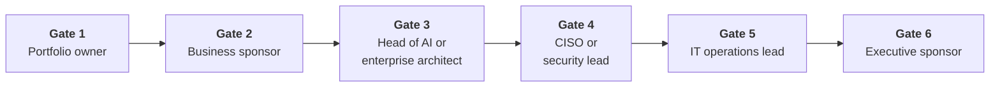

# Full RACI for the six gates

[← Back to README](../README.md) · [Framework](framework.md) · [Risk tiers](risk-tiers.md) · [Gate criteria and metrics](gate-criteria-and-metrics.md)

The framework document gives the short version: who is accountable and who is consulted. This page completes it.

| Letter | Meaning | Rule |
|---|---|---|
| **R** | Responsible: prepares the evidence and does the work | At least one per gate |
| **A** | Accountable: owns the pass or fail decision | Exactly one per gate |
| **C** | Consulted: asked before the decision | Keep the list short |
| **I** | Informed: told after the decision | |

## By gate

| Gate | Responsible | Accountable | Consulted | Informed |
|---|---|---|---|---|
| 1. Investment Prioritization | Business sponsor | Portfolio or investment owner | Head of AI, finance | AI delivery team |
| 2. Business Case Approval | AI product owner | Business sponsor | Finance, Head of AI | Portfolio owner |
| 3. Architecture and Data Readiness | Solution architect, AI delivery team | Head of AI or enterprise architect | Data governance, data owner, security architect | Business sponsor |
| 4. Security and Risk Review | AI delivery team, responsible AI reviewer | CISO or security lead | Legal and compliance, privacy lead | Business sponsor, Head of AI |
| 5. Operational Acceptance | Service owner | IT operations lead | AI delivery team, end-user representatives | Business sponsor, service desk |
| 6. Scaling Decision | AI product owner | Executive sponsor or steering committee | Head of AI, business sponsor, finance | Portfolio owner, all earlier gate reviewers |

## By role

| Role | G1 | G2 | G3 | G4 | G5 | G6 |
|---|---|---|---|---|---|---|
| Executive sponsor or steering committee | – | – | – | – | – | **A** |
| Portfolio or investment owner | **A** | I | – | – | – | I |
| Business sponsor | R | **A** | I | I | I | C |
| AI product owner | – | R | – | – | – | R |
| Head of AI | C | C | **A** | I | – | C |
| Enterprise or solution architect | – | – | R | – | – | – |
| Data governance and data owner | – | – | C | – | – | – |
| AI delivery team | I | – | R | R | C | – |
| CISO or security lead | – | – | C | **A** | – | I |
| Legal, compliance, and privacy | – | – | – | C | – | – |
| Responsible AI reviewer | – | – | – | R | – | – |
| IT operations lead | – | – | – | – | **A** | I |
| Service owner | – | – | – | – | R | – |
| End-user representatives | – | – | – | – | C | – |
| Finance | C | C | – | – | – | C |

A dash means the role has no formal part in that gate.

Where the framework says "Head of AI or enterprise architect" for Gate 3, pick one of them as the single accountable person in your organization and make the other consulted.

## How the flow looks

## Three rules

1. **One accountable person per gate.** If two people can both say yes, neither has really decided.
2. **The accountable person is independent of the team that wants to ship.** The exception is Gate 2, where the business sponsor owns the case and finance provides the independent check.
3. **Delegation follows the risk tier.** For Tier 1 projects the accountable person can name a delegate. See [risk tiers](risk-tiers.md).

## In a small organization

One person may hold several roles. A workable minimum is three people: a sponsor (Gates 1, 2, and 6), a technical lead (Gates 3 and 5), and an independent risk reviewer (Gate 4). Keep Gate 4 with someone who does not report to the delivery lead.

## Where these roles come from

The roles and committees named here are defined by your AI operating model. See the companion [AI Operating Model Playbook](https://github.com/imransheikh-ai/ai-operating-model-playbook) for how to set them up.
