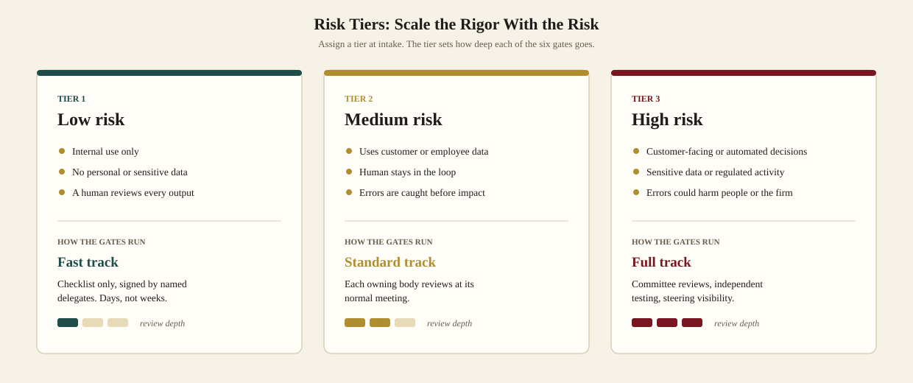
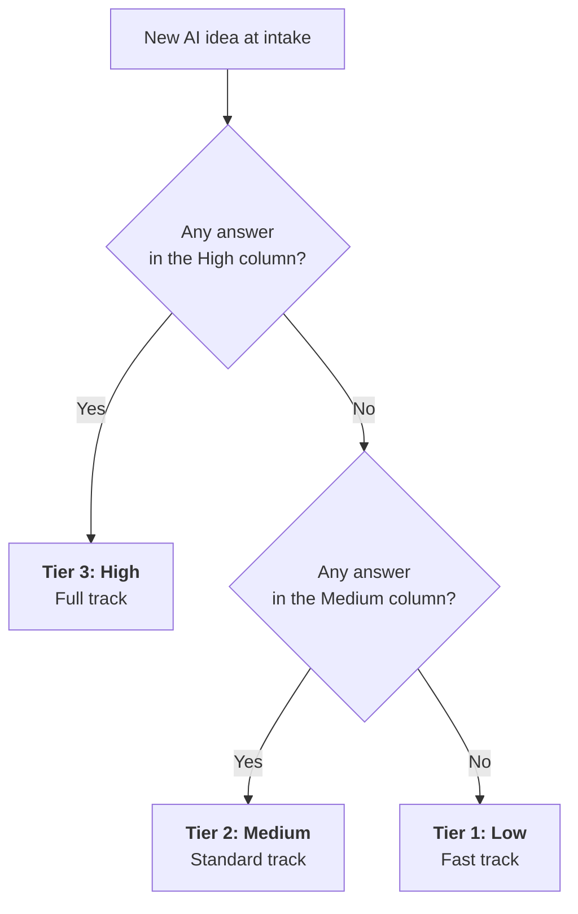

# Risk Tiers: scaling the rigor with the risk

[← Back to README](../README.md) · [Framework](framework.md) · [Full RACI](raci.md) · [Gate criteria and metrics](gate-criteria-and-metrics.md)

The six gates apply to every AI project, but they should not cost the same for every project. A drafting aid for internal notes and an automated decision about a customer are different risks. Assign a tier at intake, and let the tier set how deep each gate goes.

## Step 1. Assign the tier

Answer these five questions at intake. The **highest** answer in any row sets the tier.

| Question | Tier 1: Low | Tier 2: Medium | Tier 3: High |
|---|---|---|---|
| Who is affected by the output? | Internal staff only | Customers or employees, indirectly | Customers, employees, or the public, directly |
| What data does it use? | Public or non-sensitive internal data | Personal or confidential business data | Sensitive personal data or highly restricted data |
| How much does a human check? | A person reviews every output before use | A person reviews by sampling or on exception | It acts or decides on its own |
| What happens if it is wrong? | Minor rework | Financial, service, or reputational impact | Harm to a person, a legal breach, or major loss |
| Is the activity regulated? | No | Partly, with existing controls | Yes, directly |

The business sponsor proposes the tier. The security or risk lead confirms it. If they disagree, the higher tier applies.

## Step 2. Run each gate at the right depth

| Gate | Tier 1: Fast track | Tier 2: Standard track | Tier 3: Full track |
|---|---|---|---|
| 1. Investment Prioritization | Approved by the portfolio owner alone | Portfolio review at the normal meeting | Portfolio review with executive visibility |
| 2. Business Case Approval | One-page case, sponsor signs | Full business case, finance consulted | Full business case, finance signs, benefits owner named to the steering committee |
| 3. Architecture and Data Readiness | Uses an approved pattern, self-declared | Architecture and data review | Full review, plus data protection assessment where personal data is involved |
| 4. Security and Risk Review | Checklist signed by a delegated reviewer | Security and responsible AI review | Full review with independent testing, legal sign-off, documented human oversight |
| 5. Operational Acceptance | Named owner and an off switch | Support, monitoring, and rollback plans | Tested rollback, live monitoring with alert thresholds, incident runbook |
| 6. Scaling Decision | Sponsor decides | Sponsor and Head of AI decide | Steering committee decides |
| **Typical elapsed time for all reviews** | Days | A few weeks | Set by the review calendar |

The elapsed times are indicative. Set your own targets and measure against them.

## Step 3. Re-tier when things change

A tier is not permanent. Review it when any of these happen:

- The system starts using a new type of data
- The user group widens, especially from internal to external
- Human review is reduced or removed
- An incident occurs
- A relevant law or regulation changes

A project that moves up a tier goes back through the gates it passed at the lower depth.

## Rules that keep tiers honest

1. **Every AI project gets a tier**, including small ones and tools bought from vendors.
2. **Nobody tiers their own project alone.** The sponsor proposes, an independent reviewer confirms.
3. **Record the tier and the reasons** in the portfolio log.
4. **Sample Tier 1 projects** a few times a year to check they were rated correctly.
5. **When in doubt, go up.** Moving down later is easy. Finding a high-risk system that went through the fast track is not.

## A note on regulation

These tiers are an internal working tool. They are not a legal classification. If you are subject to AI-specific regulation or sector rules, map their categories to your tiers and let the stricter requirement apply.
